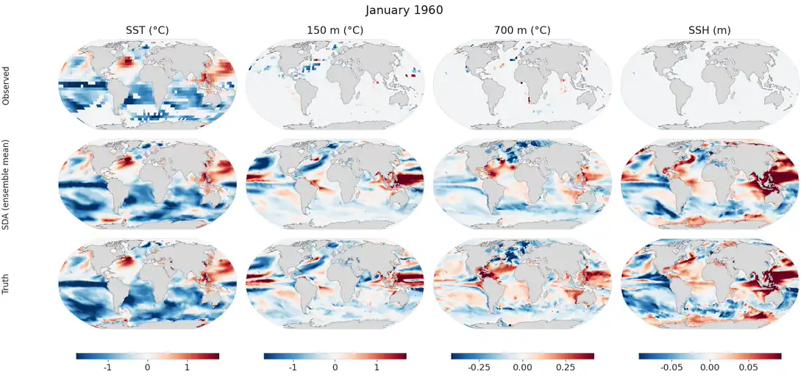
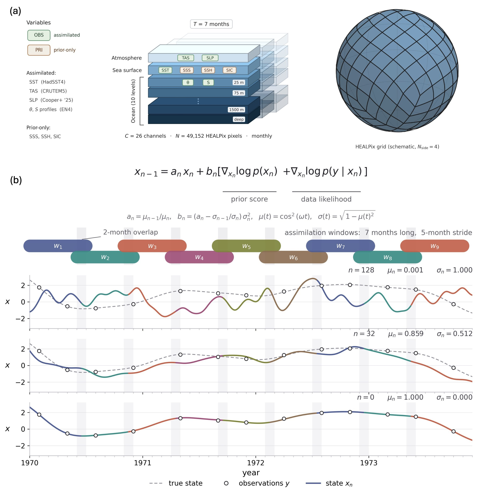

# GenDA: Historical 3D Ocean Reconstruction

**The ocean has absorbed most of the heat from global warming, yet before Argo its interior was barely observed. GenDA asks how much of the past 3D ocean the historical record can actually pin down, and answers it by conditioning a diffusion-model prior on observations instead of running an ocean model.**

Code for A. Medvedev, V. Cooper and G. Manucharyan, *Reconstructing global ocean from the historical observing record with a score-based prior* (preprint coming soon).

<p align="center">
  <a href="docs/hero.mp4"></a>
</p>

*Cross-model test, monthly from January 1960 to December 1980. The prior is trained on MIROC6 and the truth comes from CESM2, a structurally different climate model. The top row shows pseudo-observations sampled from CESM2 with the real historical coverage of each month, the middle row the SDA ensemble mean, and the bottom row the CESM2 truth. Panels show anomalies of SST, temperature at 150 m and 700 m, and sea surface height, which is not assimilated and is recovered only through covariances learned by the prior. Click the animation for the full-resolution MP4.*

## Abstract

The ocean absorbs most of the heat trapped by greenhouse gases, but until the mid-2000s it was measured only sparsely. It remains unclear how much of the past ocean, including its interior, these measurements can determine. We address this question with score-based data assimilation, in which a diffusion model trained on MIROC6 climate-model simulations learns the distribution of coupled ocean–atmosphere trajectories and is conditioned on historical observations, without running a general circulation model (GCM). Three experiments separate the sources of error: a perfect-model test against withheld MIROC6 members, a cross-model test against CESM2, and a real-world reconstruction over 1950–2020 from surface temperature, sea-level pressure, and subsurface temperature and salinity profiles. In model-world tests, the historical record determines the large-scale upper ocean back to 1950, including interior modes such as the Pacific thermocline tilt and Labrador Sea temperature at 1500 m, recovered through their learned covariance with the observed fields. In the upper ocean this covariance transfers across structurally different GCMs and, where independent data allow a test, to the real ocean. Unassimilated sea-surface height tracks satellite altimetry at large scales (median correlation 0.41), and basin-scale heat content agrees with observational products after 1990, with an earlier warm offset that is largest in the South Pacific. As observations thin out, the reconstruction increasingly follows the prior. In the cross-model test this shows up as modest biases in 300–700 m heat content and Arctic sea-ice trends and as a missed Antarctic sea-ice decline. The ensemble is underdispersed in all three experiments.

## Method



*(a) The state is a 7-month sequence of 26 channels on 49,152 HEALPix pixels, with temperature and salinity on 10 ocean levels, surface ocean fields and near-surface atmosphere. SST, land air temperature, sea level pressure and EN4 profiles are assimilated, while SSS, SSH and sea ice are constrained only by the prior. (b) Each reverse diffusion step combines the prior score from the trained denoiser with the gradient of the observation likelihood. The record is processed in 7-month windows with a 5-month stride and a 2-month overlap, shown here on a toy example from pure noise (n = 128) to the final sample (n = 0).*

Two inference modes:
- **OSSE** (`reconstruct_osse.py`) — obs *masks/grids* like the real products, but values come from a withheld MIROC6 member (you have ground truth)
- **Real obs** (`reconstruct_real_obs.py`) — HadSST / CRUTEM / ICOADS / EN4, optional DUACS SSH

Based on NVIDIA [cBottle](https://github.com/NVlabs/cBottle) ([arXiv:2505.06474](https://arxiv.org/abs/2505.06474)) and Rozet & Louppe SDA ([arXiv:2306.10574](https://arxiv.org/abs/2306.10574), [code](https://github.com/francois-rozet/sda)).

## What’s in the repo

```text
scripts/
  prepare_profiles_zarr.py          # CMIP monthly NC → HEALPix profiles zarr
  compute_profiles_climatology.py   # mean/std pickle for normalization
  prepare_en4_gridded.py            # EN4 profiles → 5° T/S zarr
  train_ocean_prior.py              # train the unconditional prior
  reconstruct_osse.py               # OSSE SDA
  reconstruct_real_obs.py           # real-obs SDA
  reconstruct_common.py             # shared SDA / EDM / mapper helpers
  profiles_dataloader.py            # zarr → training batches
  train_miroc6_base.py              # training base (don’t run directly)
  training_loop_base.py
  sda/score.py                      # VPSDE / GaussianScore_from_denoiser
configs/hyperparameters.yaml         # knobs from the runs we actually used
src/cbottle/                        # model + training helpers (from cBottle)
NOTICE                              # third-party attribution (cBottle / SDA)
```

Typical order: **prep zarr → clim pickle → train prior → reconstruct**.

## Install

```bash
pip install -e .
```

Needs Python ≥ 3.12, CUDA PyTorch, [earth2grid](https://github.com/NVlabs/earth2grid).

## 1. Make MIROC6 / CESM2 profiles zarr

Same script for both. Expects something like:

```text
INPUT_DIR/
  historical/
    r1i1p1f1/
      thetao/*.nc
      so/*.nc
      tos/*.nc
      ...
  piControl/
    r1i1p1f1/
      ...
```

It regrids to HEALPix level 6, interpolates 3D vars to 10 depths (9 levels 0–2000 m + one deep mean), and writes a structured zarr.

```bash
# MIROC6
python scripts/prepare_profiles_zarr.py \
  --input_dir /path/to/MIROC6 \
  --output_zarr /path/to/miroc6_profiles.zarr \
  --experiments historical piControl

# CESM2 (same script)
python scripts/prepare_profiles_zarr.py \
  --input_dir /path/to/CESM2 \
  --output_zarr /path/to/cesm2_profiles.zarr \
  --experiments historical \
  --regrid_dir /path/to/regrid_tmp_cesm2

# if a run died halfway:
python scripts/prepare_profiles_zarr.py ... --resume
```

Vars written:
- 3D: `thetao`, `so`
- 2D: `tos`, `sos`, `psl`, `zos`, `tas`, `siconc`

Dims: `(experiment, member, time, space)` for 2D, `(…, depth, space)` for 3D.

Then make the climatology pickle (used to normalize for training / SDA):

```bash
python scripts/compute_profiles_climatology.py \
  --zarr_path /path/to/miroc6_profiles.zarr \
  --output_path /path/to/miroc6_profiles_climatology.pkl \
  --experiment historical \
  --start_year 1990 --end_year 2014
```

## 2. Make EN4 5° zarr (for real-obs runs)

Two steps. First clim from the gap-filled EN4 analysis; then bin the raw profiles on anomalies (empty bins stay NaN — no vertical fill).

```bash
python scripts/prepare_en4_gridded.py climatology \
  --analysis_nc /path/to/en4_temp_sal_1993_onwards.nc \
  --clim_out en4_climatology.nc

python scripts/prepare_en4_gridded.py grid \
  --profiles_dir /path/to/en4_profiles \
  --clim_file en4_climatology.nc \
  --accum_zarr en4_binned_anom.zarr \
  --output_zarr en4_gridded_5deg_monthly.zarr
```

`--accum_zarr` is resumable if the job dies. Main fields in the output: `potm_mean`, `psal_mean`. Pass to reconstruction with `--en4_zarr_path`.

## 3. Train the prior

Unconditional diffusion on 26 channels (10×thetao + 10×so + 6 surface), T=7 months. Land is masked in the loss. Settings we used are in `configs/hyperparameters.yaml`.

```bash
torchrun --standalone --nproc_per_node=4 scripts/train_ocean_prior.py \
  --name miroc6_profiles_run \
  --output_dir /path/to/training-runs \
  --loop.miroc_zarr_path /path/to/miroc6_profiles.zarr \
  --loop.apply_climatology \
  --loop.climatology_path /path/to/miroc6_profiles_climatology.pkl \
  --loop.batch_gpu 8 --loop.batch_size 32 \
  --loop.time_window_months 7 \
  --loop.network.model_channels 128 \
  --loop.lr 0.00014142 \
  --loop.total_ticks 187 --loop.steps_per_tick 500
```

Checkpoint shows up as `network-snapshot-XXXXXX.pkl` under the run dir. That’s what you pass to the reconstruct scripts.

## 4. OSSE reconstruction

Real product grids/masks (HadSST 5°, CRUTEM 5°, ICOADS 2°, EN4 depths), but obs *values* = coarse-grained MIROC6 truth for `--member`. Good for checking the method when you have GT.

```bash
python scripts/reconstruct_osse.py \
  --checkpoint /path/to/network-snapshot-XXXXXX.pkl \
  --zarr_path /path/to/miroc6_profiles.zarr \
  --climatology /path/to/miroc6_profiles_climatology.pkl \
  --hadsst_path /path/to/HadSST.nc \
  --crutem_path /path/to/CRUTEM.nc \
  --icoads_path /path/to/ICOADS.nc \
  --en4_path /path/to/en4_binned_monthly.nc \
  --member r47i1p1f1 \
  --start_date 1950-01 --end_date 2014-12 \
  --noise_obs_std 0.15 --gamma 0.001 \
  --steps 128 --corrections 0 --tau 0.3 \
  --output_frames 5 --chunk_windows 2 \
  --use_bf16 --output_dir out_osse
```

For an ensemble, set `--n_ensemble N` and `--ensemble_id i` (e.g. job array).

## 5. Real-obs reconstruction

Same SDA sampler, but obs come from the actual products. Optional SSH via `--use_ssh_obs`.

```bash
python scripts/reconstruct_real_obs.py \
  --checkpoint /path/to/network-snapshot-XXXXXX.pkl \
  --climatology /path/to/miroc6_profiles_climatology.pkl \
  --en4_zarr_path /path/to/en4_gridded_5deg_monthly.zarr \
  --hadsst_path /path/to/HadSST.nc \
  --crutem_path /path/to/CRUTEM.nc \
  --icoads_path /path/to/ICOADS.nc \
  --start_date 1993-01 --end_date 2020-12 \
  --use_ssh_obs --duacs_path /path/to/duacs.nc \
  --noise_obs_std 0.15 --gamma 0.001 \
  --steps 128 --corrections 0 --tau 0.3 \
  --use_bf16 --output_dir out_real_obs
```

Channels without obs (`sos`, `zos` unless SSH, `siconc`) are filled from the prior only.

### SDA knobs that matter

| flag | meaning | value we used |
|------|---------|---------------|
| `--noise_obs_std` | obs noise in normalized space | `0.15` |
| `--gamma` | likelihood / guidance strength | `0.001` |
| `--steps` | reverse diffusion steps | `128` |
| `--corrections` | Langevin corrections per step | `0` |
| `--tau` | related to corrector step size | `0.3` |
| `--output_frames` | months kept per window | `5` |
| `--chunk_windows` | windows per GPU micro-batch | `2` |

Full train + inference configs: `configs/hyperparameters.yaml`.

## License

Apache-2.0 (`LICENSE.txt`). Copyright GenDA contributors.

Third-party bits (NVIDIA cBottle under `src/cbottle/`, SDA score utils) are listed in `NOTICE`.
